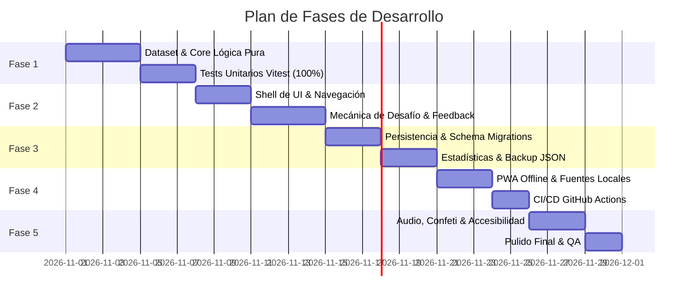

# Hoja de Ruta del Proyecto (Roadmap)

Este documento detalla la planificación por fases para el desarrollo de la aplicación web de verbos irregulares, así como la especificación de funcionalidades futuras fuera del alcance inicial (como la síntesis de voz con Web Speech API) y el backlog de extensiones.

---

## 1. Fases de Desarrollo Incremental



### [✓] Fase 1: Dataset y Core de Dominio Puro
- **Objetivo:** Construir la base de datos de 100 verbos y toda la lógica de negocio sin dependencias de UI ni navegador.
- **Entregables:**
  - [x] `src/data/verbs.json`: Lista completa de exactamente 100 verbos irregulares comunes ordenados de menor a mayor dificultad, con campos `spanish`, `present`, `past` y `participle`, utilizando operadores `&` y `|`.
  - [x] `src/core/parser/verbParser.ts`: Validador estático del JSON que comprueba formatos y prohíbe la mezcla de `&` y `|` en un mismo campo.
  - [x] `src/core/validator/answerValidator.ts`: Normalizador de respuestas (trim, minúsculas, descarte de "to ", tolerancia a separadores `,`, `;`, `/`, `.`, espacio; descarte de "and"/"y").
  - [x] `src/core/challenge/challengeEngine.ts`: Máquina de estados del desafío, gestión de cola de verbos, re-encolado ante fallos, límites de fallos (2, 1, 0, 0) y cálculo de estrellas.
  - [x] `src/core/challenge/reviewSelector.ts`: Selector ponderado de verbos de repaso histórico basado en fallos anteriores.
  - [x] `src/core/stats/statsCalculator.ts`: Funciones puras de cálculo de métricas agregadas y rachas.
  - [x] **Suite de Pruebas Unitarias:** 100% de cobertura en Vitest para todos los módulos de `src/core/`.

### Fase 2: Componentes UI y Ciclo de Juego
- **Objetivo:** Implementar la interfaz gráfica interactiva en React y Tailwind CSS, conectándola con el Core.
- **Entregables:**
  - Configuración inicial de Vite con React y TypeScript.
  - Sistema de diseño infantil: paleta de colores vibrantes, bordes redondeados y tipografía local embebida.
  - `HomeView`: Mapa vertical de niveles con nodos desbloqueados/bloqueados/superados, estrellas obtenidas y botón flotante "¡Jugar!".
  - `ChallengeView`: Formulario de pregunta de verbo con 3 inputs de texto, soporte de tecla `Enter` secuencial, vidas/corazones ❤️ y barra de progreso.
  - Componente de feedback temporalizado ante error (3-4 segundos de solución visible con cuenta atrás animada y botón "Continuar").
  - Pantallas de Victoria (cálculo de estrellas) y Derrota (mascota amigable con opción de reintentar desafío regenerado).

### Fase 3: Persistencia, Estadísticas y Gestión de Datos
- **Objetivo:** Gestionar el almacenamiento local resiliente, visualización de estadísticas y portabilidad de datos.
- **Entregables:**
  - `LocalStorageAdapter`: Gestor de `localStorage` con `schemaVersion: 1`, saneamiento de datos y fallback ante datos corruptos.
  - `StatsView`: Pantalla de estadísticas con tiempo jugado, precisión global, racha de días, mini-heatmap de actividad, ranking de verbos más fallados y verbos dominados.
  - `SettingsView`: Preferencias de sonido, botones de exportación JSON (`irregular-verbs-backup.json`), importación con validación de schema y reinicio de progreso con confirmación.

### Fase 4: PWA Offline y Pipeline de Despliegue
- **Objetivo:** Garantizar la instalación como PWA offline y automatizar el despliegue en GitHub Pages.
- **Entregables:**
  - Integración de `vite-plugin-pwa` con manifiesto Web App, iconos maskable y Service Worker con Workbox.
  - Precacheo de todos los assets estáticos, HTML, CSS, JS, JSON de verbos y fuentes WOFF2 locales.
  - Configuración de `base` relativo en Vite para compatibilidad con el subpath de GitHub Pages.
  - Workflow de GitHub Actions (`.github/workflows/deploy.yml`) con ejecución automática de tests, build y despliegue a GitHub Pages.

### Fase 5: Audio, Accesibilidad y Pulido Final
- **Objetivo:** Elevar la experiencia del usuario con sonido sintetizado, animaciones accesibles y pulido visual.
- **Entregables:**
  - `AudioService`: Sintetizador de audio ligero vía Web Audio API para efectos de acierto, error y victoria con interruptor de silencio.
  - Efectos visuales de confeti con `canvas-confetti`.
  - Soporte riguroso para `prefers-reduced-motion` y modo de alto contraste WCAG AA.
  - Atributos móviles en inputs (`autocapitalize="off"`, `autocorrect="off"`, `spellcheck="false"`, `autocomplete="off"`).
  - README completo con instrucciones de instalación, testing, despliegue y guía para contribuir verbos.

---

## 2. Especificación de Mejora Futura: Web Speech API (Pronunciación)

*Esta funcionalidad queda catalogada como fuera del alcance inmediato, pero su arquitectura técnica queda definida para su posterior integración limpia sin refactorizaciones destructivas.*

### 2.1. Propósito Educativo
Permitir a los estudiantes escuchar la pronunciación nativa en inglés británico (`en-GB`) o inglés americano (`en-US`) tanto al resolver un verbo como en las pantallas de feedback y práctica.

### 2.2. Diseño de la Interfaz Desacoplada (`SpeechService`)

```typescript
export interface ISpeechService {
  isSupported(): boolean;
  speak(text: string, options?: SpeechOptions): Promise<void>;
  stop(): void;
  getAvailableVoices(): Promise<SpeechSynthesisVoice[]>;
}

export interface SpeechOptions {
  lang?: 'en-GB' | 'en-US';
  rate?: number;  // 0.8 para estudiantes principiantes / niños
  pitch?: number; // 1.0 a 1.1 para tono amigable
  volume?: number; // 0.0 a 1.0
}
```

### 2.3. Estrategia de Implementación
1. **Detección Progresiva:** Comprobar `typeof window !== 'undefined' && 'speechSynthesis' in window`. Si el navegador no lo soporta, los botones de altavoz se ocultan elegantemente sin lanzar excepciones.
2. **Puntos de Integración en la UI:**
   - Botón de altavoz 🔊 junto a cada forma verbal en la tarjeta de feedback de error/acierto.
   - Botón de reproducción continua en la lista de verbos dominados en la pantalla de estadísticas.
3. **Manejo Offline:** Las voces instaladas nativamente por el sistema operativo (iOS, Android, Windows, macOS) funcionan 100% offline sin consumir ancho de banda.

---

## 3. Backlog de Extensiones Futuras

| ID | Funcionalidad | Descripción | Prioridad Estimada |
|---|---|---|---|
| **EXT-01** | **Listas de Verbos Temáticas / Avanzadas** | Posibilidad de seleccionar datasets adicionales: Verbos B2/C1, Verbos de Negocios o *Phrasal Verbs* irregulares. | Media |
| **EXT-02** | **Modo Desafío Contrarreloj (Time Attack)** | Modo de juego extra donde el estudiante tiene 60 segundos para acertar tantos verbos como sea posible. | Baja |
| **EXT-03** | **Sistema de Logros y Medallas** | Medallas desbloqueables (ej. "Racha de 7 días", "Maestro del Past Simple", "100 Verbos Desbloqueados"). | Media |
| **EXT-04** | **Personalización de Mascota / Avatar** | Permitir a los niños elegir su mascota (perrito, gatito, robot) y desbloquear accesorios con las estrellas conseguidas. | Baja |
| **EXT-05** | **Soporte Multilingüe (I18n)** | Adaptar las traducciones de los verbos a otros idiomas (español, francés, alemán, portugués, italiano). | Media |
