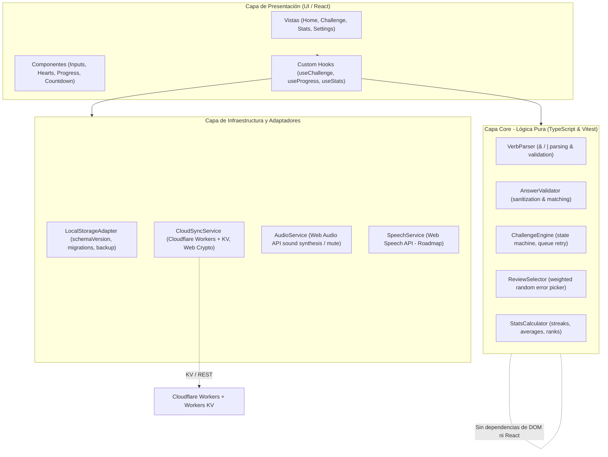

# Stack Tecnológico, Arquitectura y Despliegue

## 1. Selección y Justificación del Stack Tecnológico

El proyecto se concibe como una aplicación web estática de alto rendimiento, 100% ejecutada en el cliente (Zero-Backend), diseñada para ser desplegada en GitHub Pages y funcionar como PWA offline.

| Tecnología | Rol | Justificación |
|---|---|---|
| **Vite** | Bundler & Dev Server | Arranque instantáneo (HMR ultrarrápido vía ES modules), compilación optimizada con Rollup, configuración sencilla de base path para GitHub Pages y excelente ecosistema de plugins. |
| **TypeScript (Strict)** | Lenguaje principal | Tipado estricto en tiempo de compilación (`strict: true`), garantizando la robustez de las reglas de dominio, validaciones de gramática y contratos de persistencia. |
| **React 18+** | Biblioteca UI | Paradigma declarativo por componentes, gestión predecible de estados y transiciones visuales, ideal para la jerarquía de vistas y modales del juego. |
| **Tailwind CSS / CSS Modules** | Sistema de Estilos | Utilidades atómicas y variables CSS personalizadas para una estética infantil limpia, adaptable, responsive y con soporte nativo de `prefers-reduced-motion`. |
| **Vitest** | Framework de Testing | Integración nativa con la configuración de Vite, ejecución ultra rápida de tests unitarios, soporte de cobertura y compatibilidad con APIs de Jest/Node. |
| **vite-plugin-pwa** | PWA & Service Worker | Generación automática de Service Worker (Workbox), precaching de todos los assets estáticos, fuentes y datos, y gestión del Web App Manifest con soporte para subpaths. |
| **Canvas Confetti** | Efectos Visuales | Biblioteca ligera para lanzar confeti en las pantallas de victoria, configurable para desactivarse en modo de movimiento reducido. |

---

## 2. Arquitectura de Software en Capas Desacopladas

La aplicación sigue los principios de **Clean Architecture / Hexagonal Architecture**, aislando estrictamente la lógica de negocio pura de la capa de interfaz de usuario y de los mecanismos de almacenamiento.



### 2.1. Capa Core (`src/core/`)
- **Regla de oro:** No contiene importaciones de React, DOM, `window` ni `localStorage`.
- **Estructura interna:**
  - `parser/verbParser.ts`: Analiza las cadenas de conjugación, valida la presencia de operadores `&` y `|`, y prohíbe su combinación en un mismo campo.
  - `validator/answerValidator.ts`: Normaliza las entradas del usuario (trim, minúsculas, descarte de prefijo `"to "`), procesa separadores admitidos (`,`, `;`, `/`, `.`, espacio) y verifica si las respuestas satisfacen las condiciones del verbo.
  - `challenge/challengeEngine.ts`: Gestiona la máquina de estados de un desafío (cola de verbos, re-encolado ante fallos, contador de vidas y cálculo de estrellas).
  - `challenge/reviewSelector.ts`: Algoritmo ponderado para seleccionar verbos de repaso histórico basándose en el ratio de fallos acumulados en niveles previos.
  - `stats/statsCalculator.ts`: Funciones puras para procesar métricas de rachas de días, tiempos medios de respuesta, porcentajes de acierto y rankings de dificultad.

### 2.2. Capa de Infraestructura y Adaptadores (`src/storage/`, `src/services/`)
- `storage/storageAdapter.ts`:
  - Lee y escribe en `localStorage` encapsulando la clave `irregular_verbs_data`.
  - Verifica la versión del esquema (`schemaVersion: 1`).
  - Ejecuta migraciones automáticas o restablecimiento seguro si los datos están desactualizados o corruptos.
  - Funciones puras para serialización / deserialización de backups JSON con validación de tipo y schema.
- `services/cloudSyncCrypto.ts`:
  - Normalización de nombres de usuario (`NFKC`, trim, lowercase, colapso de espacios).
  - Derivación determinista e irreversible de identificadores de repositorio remoto usando Web Crypto SHA-256 con prefijo de longitud para evitar colisiones y filtración de contraseñas.
- `services/cloudSyncService.ts`:
  - Cliente REST desacoplado para consultar (`GET` / `HEAD`) y subir (`PUT`) el documento único JSON a Cloudflare Workers con Workers KV.
- `services/audioService.ts`:
  - Generador de efectos de sonido sintetizados mediante Web Audio API (o audio tags ligeros) para acierto, fallo, clic y victoria.
  - Respeta el ajuste global de silencio (`soundEnabled`).
- `services/speechService.ts`:
  - Interfaz abstracta para síntesis de voz (preparada para la futura integración de Web Speech API).

### 2.3. Capa de Presentación (`src/components/`, `src/views/`, `src/hooks/`)
- `views/HomeView.tsx`: Mapa vertical de niveles, desafíos y acceso directo a jugar.
- `views/ChallengeView.tsx`: Tablero de desafío interactivo con 3 campos de texto, feedback temporalizado y barra de progreso.
- `views/StatsView.tsx`: Dashboard de métricas, historial de actividad y ranking de errores.
- `views/SettingsView.tsx`: Preferencias de sonido, importación/exportación JSON y reinicio de progreso.
- `components/ui/`: Botones redondeados, inputs accesibles, barra de cuenta atrás, corazones de vidas y modales de feedback.
- `hooks/`: Conectores React que suscriben la UI a la máquina de estados del core y sincronizan con el almacenamiento local.

---

## 3. Compatibilidad y Despliegue en GitHub Pages

GitHub Pages aloja la aplicación como un sitio web estático bajo un subpath de repositorio (ej. `https://<usuario>.github.io/<nombre-repo>/`).

### 3.1. Configuración de Base Path en Vite
En `vite.config.ts`:
```typescript
import { defineConfig } from 'vite';
import react from '@vitejs/plugin-react';
import { VitePWA } from 'vite-plugin-pwa';

export default defineConfig({
  // Permite base relativo o configurable vía variable de entorno para CI/CD
  base: process.env.BASE_URL || './',
  plugins: [
    react(),
    VitePWA({
      /* Configuración PWA descrita en sección 4 */
    })
  ]
});
```

### 3.2. Estrategia de Navegación (Evitar History API)
Dado que GitHub Pages no realiza redirecciones `SPA fallback` a `index.html` en rutas profundas sin hacks de 404:
- **Enfoque Obligatorio:** Navegación controlada por **Estado Interno** (`currentView: 'home' | 'challenge' | 'stats' | 'settings'`) o **Hash Routing** (`#/map`, `#/challenge/:level/:challengeIndex`, `#/stats`, `#/settings`).
- Todas las referencias a imágenes, fuentes y audios deben utilizar rutas relativas o resolverse mediante imports de Vite (ej. `import logo from './assets/logo.svg'`).

### 3.3. Pipeline de Integración Continua (GitHub Actions)
Archivo de flujo de trabajo `.github/workflows/deploy.yml`:
```yaml
name: Deploy to GitHub Pages

on:
  push:
    branches: [ main ]
  workflow_dispatch:

permissions:
  contents: read
  pages: write
  id-token: write

concurrency:
  group: "pages"
  cancel-in-progress: false

jobs:
  build-and-test:
    runs-on: ubuntu-latest
    steps:
      - name: Checkout repository
        uses: actions/checkout@v4

      - name: Setup Node.js
        uses: actions/setup-node@v4
        with:
          node-version: 20
          cache: 'npm'

      - name: Install dependencies
        run: npm ci

      - name: Run unit tests
        run: npm test -- --run

      - name: Build static site
        run: npm run build
        env:
          BASE_URL: ./${{ github.event.repository.name }}/

      - name: Setup Pages
        uses: actions/configure-pages@v5

      - name: Upload artifact
        uses: actions/upload-pages-artifact@v3
        with:
          path: './dist'

  deploy:
    environment:
      name: github-pages
      url: ${{ steps.deployment.outputs.page_url }}
    runs-on: ubuntu-latest
    needs: build-and-test
    steps:
      - name: Deploy to GitHub Pages
        id: deployment
        uses: actions/deploy-pages@v4
```

---

## 4. Arquitectura PWA Offline y Recursos Locales

### 4.1. Configuración de `vite-plugin-pwa`
Para garantizar que la PWA se instale y funcione sin conexión tanto en la raíz como en el subpath de GitHub Pages:

```typescript
VitePWA({
  registerType: 'autoUpdate',
  includeAssets: ['favicon.ico', 'robots.txt', 'fonts/*.woff2', 'audio/*.mp3'],
  manifest: {
    name: 'Verbos Irregulares en Inglés',
    short_name: 'Verbos Inglés',
    description: 'Aprende los 100 verbos irregulares jugando nivel a nivel',
    theme_color: '#4F46E5',
    background_color: '#F8FAFC',
    display: 'standalone',
    orientation: 'portrait',
    start_url: './',
    scope: './',
    icons: [
      {
        src: 'pwa-192x192.png',
        sizes: '192x192',
        type: 'image/png'
      },
      {
        src: 'pwa-512x512.png',
        sizes: '512x512',
        type: 'image/png',
        purpose: 'any maskable'
      }
    ]
  },
  workbox: {
    globPatterns: ['**/*.{js,css,html,ico,png,svg,woff2,json,mp3}'],
    navigateFallback: 'index.html'
  }
})
```

### 4.2. Fuentes y Tipografías Embebidas Localmente
- Para mantener la estética infantil amigable sin depender de peticiones externas a Google Fonts CDN (lo que rompería el modo offline):
  - Se utilizan tipografías de libre distribución de estilo redondeado: **Fredoka** o **Baloo 2**.
  - Los archivos `.woff2` optimizados se alojan localmente en `src/assets/fonts/` o `public/fonts/`.
  - Se declaran mediante reglas `@font-face` con `font-display: swap` en los estilos globales.

---

## 5. Directrices de Accesibilidad (A11y) y UX Móvil

### 5.1. Configuración de Inputs de Respuesta
Para evitar que los teclados móviles interfieran en la escritura de verbos con autocorrecciones o mayúsculas involuntarias, los inputs deben incluir obligatoriamente:

```html
<input
  type="text"
  autocapitalize="off"
  autocorrect="off"
  spellcheck="false"
  autocomplete="off"
  aria-label="Presente del verbo"
/>
```

### 5.2. Flujo de Navegación por Teclado
- Al presionar la tecla `Enter`:
  1. Si el foco está en el input *Present* $\rightarrow$ se enfoca el input *Past*.
  2. Si el foco está en el input *Past* $\rightarrow$ se enfoca el input *Participle*.
  3. Si el foco está en el input *Participle* $\rightarrow$ se envía y evalúa la respuesta del verbo.

### 5.3. Contraste de Color y Movimiento Reducido
- **Contraste WCAG 2.1 AA:** Todo texto e icono interactivo mantiene un ratio de contraste mínimo de $4.5:1$ frente a su fondo.
- **Soporte para `prefers-reduced-motion`:**
  - Cuando la media query `(prefers-reduced-motion: reduce)` esté activa o el usuario lo configure en Ajustes:
    - Se cancelan las explosiones de confeti.
    - Las animaciones de rebote y pulso se reemplazan por transiciones instantáneas o cambios sutiles de opacidad.
